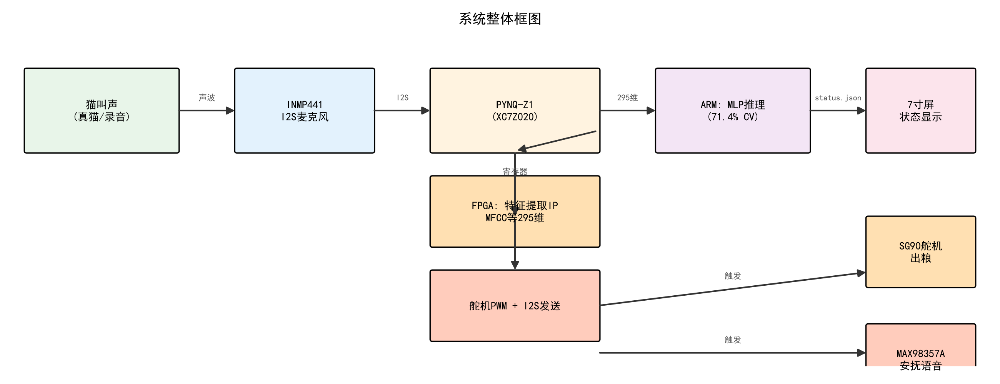

# 猫叫情境识别与智能照料系统

基于 FPGA 的猫叫情境识别系统,参加 2026 年 FPGA 创新设计竞赛(AMD 自主选题组,团队编号 40713)。

## 简介

猫叫音频以 16 kHz 采样进入 PYNQ-Z1(Zynq-7020)。FPGA 可编程逻辑中的特征提取 IP(由 Vitis HLS 综合)以硬件流水线方式计算 295 维整窗特征与 885 维分段特征,单次约 1.1 秒;ARM 端运行双 MLP 集成推理,把叫声分为三类情境:梳理放松、等待喂食、环境焦虑。

识别为等待喂食时,连续两段确认后输出舵机 PWM 控制信号(板载指示灯同步指示);识别为环境焦虑时,经 I2S 发送模块输出安抚音频;梳理放松不动作。识别状态每秒写入 status.json,供演示界面显示。



## 性能指标

| 指标 | 数值 |
|---|---|
| 五折交叉验证准确率 | 71.4% |
| 板级金标准对拍 | 40/40 通过,最大概率偏差 0.0004 |
| 特征 IP 资源 | BRAM 200/280,DSP 111/220,113 MHz |
| 单次特征提取 | 约 1.1 秒(24000 采样点) |
| 连续运行 | 16 轮 × 40 段无故障 |

## 目录结构

```
firmware/    板端脚本(裸板方式:/dev/mem + sysfs fpga_manager)
  cat_golden/   40 段真实猫叫测试音频
  cat_weights/  model1/model2 权重
training/    PC 端训练、交叉验证、金标准导出、C 参考实现
fpga/        HLS 源码、overlay 构建脚本、比特流
display/     演示界面程序、屏幕 UI 设计说明
enclosure/   激光切割外壳图纸(DXF + 工程图 + 组装说明)
docs/        项目报告、系统框图
```

## 快速开始(上板运行)

板子为自建 PYNQ 3.1 镜像,无 XRT、无 pynq 库,脚本不依赖任何第三方运行时。

1. 文件放置:
   - `fpga/bitstream/cat_overlay.bit` → `/home/xilinx/`
   - `firmware/cat_golden/` → `/home/xilinx/cat_golden/`
   - `firmware/cat_weights/` → `/home/xilinx/cat_weights/`
   - `firmware/*.py` → `/opt/m1/`(不要放 `/home/xilinx/`,该目录下的 pynq 文件夹会遮蔽同名库)
2. 对拍验证:`sudo python3 /opt/m1/01_m1_对拍验证.py`,预期 40/40 通过
3. 实时演示:`sudo python3 /opt/m1/02_m2_live.py`
4. 演示界面:PC 端运行 `display/serial_ui.py`,读取 PuTTY 串口会话日志
   (PuTTY 中 Logging 选 All session output,日志路径改为 serial_ui.py 中 LOG 变量的值)

## 复现步骤

1. 训练:进入 `training/改进算法/`,依次运行 `02_训练评估.py`、`09_最终模型.py`
2. HLS:Vitis HLS 2022.1 运行 `fpga/run.tcl`(csim 对拍 + 综合),再运行 `fpga/export.tcl` 导出 IP 包,命名为 ip_repo
3. overlay:Vivado 2022.1 批处理运行 `fpga/build_overlay_v5.tcl`。
   注意:Vivado 对 AXI-Lite 从机段分配默认封顶 64K,特征 IP 的 PCM 寄存器在 0x10000 偏移,
   脚本内已做地址段修正,勿删
4. 部署:按"快速开始"一节上板

## 寄存器地址(v5 overlay)

| 模块 | 基地址 | 说明 |
|---|---|---|
| 特征 IP | 0x40000000 | ap_ctrl 0x00;feat_out 0x2000(1180 float);pcm_packed 0x10000(12000 int32,每寄存器 2 个 int16 样本) |
| I2S 发送 | 0x40020000 | ap_ctrl 0x00;pcm_packed 0x10(12000 int32) |
| 舵机 PWM | 0x40030000 | ap_ctrl 0x00(while(1) 模块,启动写 1);width 0x10;period 0x18(单位 0.1 us) |

引脚:Pmod A 1 脚 Y18(舵机 PWM),2 脚 Y19(BCLK),3 脚 Y16(WS),4 脚 Y17(DIN),7 脚 U18(播放完成)。

## 说明

- 演示音源为 40 段真实猫叫录音,保证识别结果可复现;麦克风实时采集为预留接口
- 出粮动作当前以舵机 PWM 信号输出与板载指示灯演示,机械出粮机构为预留接口
- 演示视频见竞赛提交材料,仓库内为代码与设计文件

## 许可证

MIT License
